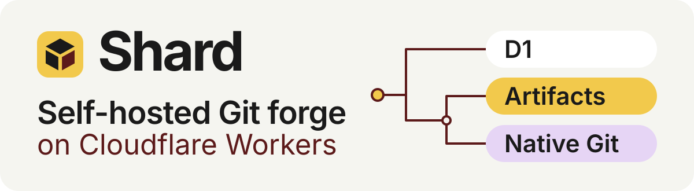

<h1></h1>

Shard brings public and private repositories, issues, and pull request review
together for personal projects and small teams. Standard Git clients clone,
fetch, and push over HTTPS. The web interface supports English and Simplified Chinese.

[][cloudflare-deploy] · [Deploy Paid with R2 multipart uploads](#deploy-paid-with-r2-multipart-uploads)

[Run locally](#local-development) · [First push](#first-repository) · [Deploy guide](#deploy-to-cloudflare) · [简体中文](#简体中文)

<a href="assets/readme/pull-request.webp"></a>

A line review in `demo/field-notes` on a local Shard instance.

## Local development

Install Git 2.32+ and mise, then run these commands from the checkout.

```sh
mise install
mise run setup
mise run dev
```

Open <http://localhost:8787>. Wrangler runs D1 and SQLite Durable Objects locally.
You can create and push a repository without a Cloudflare account.

### First repository

1. Create an account at `/user/sign_up`. Registration is open on the instance.
2. Choose **New repository** and set its visibility. Create a write token in
   **Account settings → Access tokens** and save it when Shard displays it.
3. Copy the repository's clone URL into `SHARD_CLONE_URL`. When Git prompts for
   the push, enter your Shard username and use the write token as the password.

```sh
git clone "$SHARD_CLONE_URL" my-repository
cd my-repository
printf '# My repository\n' > README.md
git add README.md
git commit -m "Initial commit"
git push -u origin HEAD:main
```

<details>
<summary>Build, tests, and editor setup</summary>

`mise run check` type-checks the Worker and `mise run lint` runs Clippy.
`mise run build` produces `build/index.js`. `mise run test` builds and tests
all three backends with isolated data. `npm test` uses an existing build.
Keep Git on `PATH`, including in CI.

`mise run setup` installs the pinned toolchain, editor tools and npm dependencies.
For rust-analyzer, set the Cargo target to `wasm32-unknown-unknown`.

Native merge regressions require Git 2.38 or later. When Git LFS is installed,
the LFS regressions also exercise uploads and clones with the real client.
</details>

## Features

- **Browse and search code** by Git ref. Find paths, text, and commits within a
  bounded scan. Results link to the searched commit. View a file, stream the
  full contents, or download a commit-pinned source archive.
- **Collaborate** with scoped Git tokens, repository collaborators, organization
  teams, forks, imports, and transfers. Existing URLs keep their permission
  checks after rename or transfer.
- **Review and merge** pull requests from a branch or another repository.
  Accepted pushes schedule a comparison refresh. Reviews and line comments
  link to their original snapshot. Protected branches can require approvals
  and CI results before the merge queue advances the target ref.
- **Organize work** with issue templates, reactions, label and assignee filters,
  milestones, repository watches and stars, and a permission-aware inbox.
  Repository writers can draft and publish releases pinned to Git tags.
- **Integrate** CI results and signed repository webhooks for issues, pull
  requests, branch updates, and tag updates.
- **Customize your profile** with an uploaded avatar. Commit lists, branch
  summaries, and commit details use it when the Git author email matches
  your account email. Other authors use their initials.

## Architecture

The Rust Worker serves the web interface and checks repository access before
forwarding Git traffic. D1 keeps accounts, permissions, issues, and reviews.
The default deployment gives each repository a SQLite Durable Object for Git
objects and refs. Paid deployments can use Cloudflare Artifacts, and the
`native` environment uses an authenticated Git server with persistent disk.
Any environment with a private `LFS_OBJECTS` R2 binding can store Git LFS bytes.

[Storage design](PLAN.md#optional-git-backends) · [Verified behavior and staging status](STATUS.md)

## Deploy to Cloudflare

Use the **Workers Free** deployment for a new forge. It provisions D1 and
SQLite Durable Objects. You can sign up, create public or private repositories,
push over HTTPS, open pull requests, and use issues and reviews immediately.

| Deployment | Git storage | Git LFS | Services and account requirements |
| --- | --- | --- | --- |
| Default (`shard-free`) | SQLite Durable Objects | Optional R2 binding | Workers Free, D1, Static Assets, Rate Limiting, Cron |
| `npm run deploy:paid` (`managed` or `managed-staging`) | Artifacts | R2 multipart | Workers Paid with Artifacts and Containers access, Workflows, private R2 and scoped S3 credentials |
| `--env artifacts` (`shard`) | Artifacts | R2 proxy by default | Upgrade path for the original Artifacts instance, with Workers Paid and R2 |
| `--env native` (`shard-native`) | Your Git server | R2 proxy by default | Workers Free or Paid, a reachable HTTPS Git origin with persistent storage, and R2 |

Give each instance separate D1, Git storage, and any R2 resources.
[Durable Object limits](https://developers.cloudflare.com/durable-objects/platform/limits/) · [Artifacts pricing](https://developers.cloudflare.com/artifacts/platform/pricing/) · [Enable R2](https://developers.cloudflare.com/r2/buckets/create-buckets/)

### Deploy from GitHub or GitLab

1. Click **Deploy to Cloudflare** and select your account.
2. Connect GitHub or GitLab and confirm the destination repository, Worker
   name and D1 database. The default template also provisions its SQLite
   Durable Object class through the `free-git-v1` migration.
3. Keep the repository root as the build root, `npm run build` as the build
   command, and `npm run deploy` as the deploy command. Click **Deploy** and
   open the `workers.dev` URL when the build finishes.
4. Follow [First repository](#first-repository) to verify registration, repository
   creation and the first push.

For a repository you already own, connect it in Workers & Pages and use the
same commands. The build token needs Workers Scripts Edit and D1 Edit in
the target account. Add Workers Routes Edit when deploying routes in a zone.
Workers Builds uses `.node-version`, the pinned Rust toolchain and `worker-build`.
The deploy command applies the D1 migrations before publishing the Worker.
[Deploy to Cloudflare buttons](https://developers.cloudflare.com/workers/platform/deploy-buttons/) · [Workers Builds settings](https://developers.cloudflare.com/workers/ci-cd/builds/configuration/)

### Deploy from a local checkout

Set up the toolchain from the local development section, then authenticate and
deploy from the checkout.

```sh
mise exec -- npx wrangler login
mise run deploy
```

The deploy script uses the selected environment's `DB` binding. With the
placeholder ID or no ID, it resolves D1 by `database_name` or creates it.
Automatic reuse accepts an empty database or a schema with Shard's initial
migration and core tables. To select an existing database explicitly, set its
UUID in `database_id`. The script applies pending migrations, then Wrangler
publishes the Worker with the selected bindings.

For another instance, choose a Worker and D1 name in `wrangler.jsonc`. Where
configured, choose unique R2 bucket and Artifacts namespace names. Pass
`--config PATH` to choose another config or `--env NAME` to select an
environment. Use the same Cloudflare account throughout. For CI or explicit
account selection, set `CLOUDFLARE_ACCOUNT_ID` and supply `CLOUDFLARE_API_TOKEN`
through the build environment. To check the bundle locally, run
`mise exec -- npm run deploy -- --dry-run`.
[Wrangler authentication](https://developers.cloudflare.com/workers/wrangler/commands/general/#login) · [D1 migrations](https://developers.cloudflare.com/d1/reference/migrations/) · [Wrangler resource provisioning](https://developers.cloudflare.com/workers/wrangler/configuration/#automatic-provisioning)

### Deploy Paid with R2 multipart uploads

Use the Paid preset from a source checkout or prebuilt release. Its default
target is `managed`. Use `--env managed-staging` for an independent staging
instance. Use Workers Paid with Artifacts and Containers access, an available
Docker engine, and a private R2 bucket. For a source checkout, install the
pinned toolchain as in [Local development](#local-development).

1. In the selected Wrangler environment, set the Worker name and the D1,
   Artifacts, Workflow and `LFS_OBJECTS` names for this instance. Create the
   private R2 bucket and a bucket-scoped **Object Read & Write** credential.
   Configure the `lfs-incoming/` rule in [Git LFS upload modes](#git-lfs-upload-modes).
2. Set `CLOUDFLARE_ACCOUNT_ID` in your shell and authenticate Wrangler. Save the
   credential in `.env.deploy.paid` with `SHARD_LFS_R2_ACCESS_KEY_ID` and
   `SHARD_LFS_R2_SECRET_ACCESS_KEY` as the two variable names.
3. Run this from a source checkout. In a prebuilt release, run the same command
   without `mise exec --`, using the included Node version.

   ```sh
   mise exec -- npm run deploy:paid -- --secrets-file .env.deploy.paid
   ```

The command derives the R2 S3 endpoint from the account and bucket jurisdiction,
configures the Artifacts origin, applies D1 migrations and deploys with
`SHARD_LIMIT_PROFILE=paid` and `SHARD_LFS_UPLOAD_MODE=r2-multipart`. Run
`npm run deploy:paid -- --dry-run` to bundle locally without Cloudflare credentials.
The preset gives the Worker up to 300,000 ms of CPU and 20,000 subrequests
per invocation by default. Configure the [Git LFS transfer adapter](#git-lfs-upload-modes)
in each client checkout that uploads LFS files.

### Upgrade an existing Artifacts deployment

Use `npm run deploy -- --env artifacts` for the original Artifacts instance
or set that command in its existing Workers Builds configuration. Before
upgrading, carry the exact Worker name, D1 `database_id`, Artifacts namespace,
R2 bucket, routes and optional bindings from that instance into `env.artifacts`.
The migration keeps each repository's existing Git backend, storage ID, and
LFS keys. Use separate resources for a fresh Free deployment.

### Deploy with managed Cloudflare services

The `managed` and `managed-staging` environments add a Durable Object per target
branch, a repository copy Workflow, and a Containers image for Web merges that
need native Git. They use separate Workers, D1 databases, R2 buckets, Artifacts
namespaces, and Workflow names. Use Workers Paid with Artifacts and Containers
available in the target account.

Before the first managed release, set `SHARD_GIT_ARTIFACTS_ORIGINS` in the
`vars` of both environments to the exact HTTPS Git origin for that account,
for example `https://<ACCOUNT_ID>.artifacts.cloudflare.net`. You can instead
set it as a text variable on each existing Worker. [Artifacts Git HTTPS](https://developers.cloudflare.com/artifacts/api/git-protocol/)

In the `shard-managed` Worker's **Settings → Build**, connect the repository
and keep the repository root as the build root. Configure the production branch
as `main` or set the build variable `SHARD_RELEASE_BRANCH` to your chosen
production branch. Use the following commands.

| Workers Builds setting | Command |
| --- | --- |
| Build command | `npm run ci -- --container` |
| Deploy command | `npm run cd` |

CI builds the Worker, runs the isolated regressions, and starts the Git bridge
image to check its health and authentication. CD deploys the checkout SHA to
staging, then waits for the release Workflow to verify the version tag, D1
schema, R2 access, CSS, and Git bridge readiness. Once staging passes, CD
deploys the same SHA to production and verifies it there after activation. If
that check fails, the release command reports the Workflow instance to inspect.
Workers Builds reports the build and deploy result on the linked commit.
After deploying with the Paid preset, this staged release path retains its
dashboard-managed LFS settings through `keep_vars`. Use matching R2 settings
and secrets in both environments when staging multipart uploads.
[Migrate GitHub Actions jobs to Cloudflare](PLAN.md#migrate-github-actions-jobs-to-cloudflare)

If you enable builds for other branches, leave their preview command separate
from `npm run cd`. The release script checks the Workers Builds branch and
checkout SHA. Use a build token limited to the target account with Workers
Scripts Edit, D1 Edit and Workers R2 Storage Edit. Add Workers Routes Edit
when deploying custom routes. [Workers Builds settings](https://developers.cloudflare.com/workers/ci-cd/builds/configuration/) · [Container deployment](https://developers.cloudflare.com/containers/guides/deploy/) · [Workflow instance permissions](https://developers.cloudflare.com/api/resources/workflows/subresources/instances/methods/create/)

With Docker running, verify both bundles and their configured image from the
source checkout.

```sh
mise exec -- npm run cd -- --dry-run
```

For the first staged release, configure both environments and authenticate
Wrangler, then run the same commands Workers Builds uses. This creates the
Workers so you can connect `shard-managed` to the repository in the dashboard.

```sh
mise exec -- npm run ci -- --container
mise exec -- npm run cd
```

### Worker variables and secrets

In the Cloudflare dashboard, open **Workers & Pages → your Worker → Settings → Variables and Secrets**.
Choose **Add**, enter the name and value as **Text** or **Secret**, and deploy
the change. For a named Wrangler environment, open that environment's Worker,
such as `shard-native`. These are runtime settings. Workers Builds variables
configure the build process separately.

| Type | Settings |
| --- | --- |
| Text | `PUBLIC_ORIGIN`, `EMAIL_FROM`, `NATIVE_GIT_ORIGIN`, `SHARD_LIMIT_PROFILE`, `SHARD_LFS_UPLOAD_MODE`, `SHARD_LFS_MAX_BYTES`, `SHARD_LFS_R2_ENDPOINT`, `SHARD_LFS_R2_BUCKET`, `WEBHOOK_ENDPOINT` and `WEBHOOK_REPO` for the legacy integration |
| Secret | `NATIVE_GIT_TOKEN`, `SHARD_LFS_R2_ACCESS_KEY_ID`, `SHARD_LFS_R2_SECRET_ACCESS_KEY`, `WEBHOOK_ENCRYPTION_KEY`, `WEBHOOK_SECRET` for the legacy integration |

The shipped `keep_vars: true` preserves dashboard variables across Wrangler
deployments. For each dashboard-managed text variable, omit the corresponding
key from Wrangler `vars` in that environment. Values declared in `vars` are
uploaded on every deploy. Wrangler retains existing secrets, and you can
supply required secrets on a first deployment with `--secrets-file PATH`.
The file accepts JSON or dotenv. Files named `.env.deploy` and
`.env.deploy.*` are ignored by Git.
Keep resource bindings, routes and Cron Triggers in the Wrangler configuration.
[Dashboard environment variables](https://developers.cloudflare.com/workers/configuration/environment-variables/#add-environment-variables-via-the-dashboard) · [Workers secrets](https://developers.cloudflare.com/workers/configuration/secrets/#secrets-on-deployed-workers) · [Wrangler configuration precedence](https://developers.cloudflare.com/workers/wrangler/configuration/#source-of-truth)

### Deploy with a native Git origin

Choose the `native` Wrangler environment to use a Git server you operate. It
uses D1, R2, static assets and a rate limiter on Cloudflare, and stores bare Git
repositories on the origin's disk. Repository URLs and Shard token scopes are
the same across backends. `GIT_BACKEND` selects storage for new repositories and
credential-free imports. A fork uses its source's backend. Existing repositories
retain their recorded backend.

1. Run `node scripts/git-origin.mjs` on a host with the pinned Node version and
   Git 2.32 or later. Set `SHARD_GIT_DIRECTORY` to a dedicated directory on a
   persistent volume and `SHARD_GIT_TOKEN` to a randomly generated shared
   secret. The service defaults to `127.0.0.1:8793`. Run one process per volume
   and put it behind an HTTPS reverse proxy that streams request bodies.
2. In `env.native.vars`, set `NATIVE_GIT_ORIGIN` to the proxy's HTTPS origin.
   To manage it through the dashboard on an existing Worker, remove the
   loopback entry from the file and set the dashboard variable on that Worker.
   Use a dedicated origin directory and token per instance.
3. For a new Worker, put `NATIVE_GIT_TOKEN` in `.env.deploy.native` with the
   same value as `SHARD_GIT_TOKEN`. Deploy the native environment with that file.

   ```sh
   mise exec -- npm run deploy -- --env native --secrets-file .env.deploy.native
   ```

   On subsequent deploys, omit `--secrets-file` to use the existing Worker secret.

For Windows or Linux local development, start the origin with a disposable
directory and token. Put `NATIVE_GIT_TOKEN` in `.dev.vars.native` and run:

```sh
mise exec -- npx wrangler d1 migrations apply DB --env native --local
mise exec -- npx wrangler dev --env native --local
```

Native imports accept final HTTPS Git URLs from `github.com`, `gitlab.com`,
and `codeberg.org` by default. Set `SHARD_GIT_IMPORT_HOSTS` on the origin to
replace the list with trusted hostnames. The import form accepts Basic or
Bearer credentials. Credentialed copies use the configured native origin even
when Artifacts is the default. They start as private repositories, and the
minute cron advances pending copies.

Back up the origin volume separately from D1. To keep serving legacy Artifacts
repositories, retain the Artifacts binding alongside the native origin until
those repositories are migrated. Native non-fast-forward Web merges require
Git 2.38 or later.
[Wrangler environments](https://developers.cloudflare.com/workers/wrangler/environments/) · [Git backend plan](PLAN.md#optional-git-backends)

### Web merges on Artifacts

Artifacts supports same-repository fast-forwards through Git HTTPS. Managed
environments send divergent and cross-repository Artifacts merges to the Git
merge container. Other Artifacts deployments can point `NATIVE_GIT_ORIGIN`
and `NATIVE_GIT_TOKEN` at a Git 2.38+ origin and set
`SHARD_GIT_ARTIFACTS_ORIGINS` on that host. The bridge stages the reviewed
objects and pushes one branch with a lease on the expected target tip.
Mixed-backend Web merges require manual integration and verification.

### Optional email setup

Set `PUBLIC_ORIGIN` to the HTTPS origin of your instance and `EMAIL_FROM` to an
address on your onboarded sending domain. Add `send_email` to the selected
Wrangler environment with `[{ "name": "EMAIL", "allowed_sender_addresses":
["shard@example.com"] }]`, using your own sender address. Verification links
expire after 24 hours. Password-reset links expire after 30 minutes and a
successful reset revokes all browser sessions for the account.
[Email Sending and domain onboarding](https://developers.cloudflare.com/email-service/get-started/send-emails/) · [`send_email` binding](https://developers.cloudflare.com/email-service/configuration/send-bindings/)

### Cloudflare services used by Shard

| Service | Role | Official documentation |
| --- | --- | --- |
| Workers and Static Assets | Serve the Rust/Wasm Worker and static files through `ASSETS`. | [Workers](https://developers.cloudflare.com/workers/) · [Static Assets binding](https://developers.cloudflare.com/workers/static-assets/binding/) · [Custom domains](https://developers.cloudflare.com/workers/configuration/routing/custom-domains/) |
| D1 | Store accounts, permissions, repository metadata and review history in `DB`. | [D1](https://developers.cloudflare.com/d1/) · [Migrations](https://developers.cloudflare.com/d1/reference/migrations/) |
| Artifacts | Store Git repositories in the Artifacts and managed environments through `ARTIFACTS`. | [Artifacts](https://developers.cloudflare.com/artifacts/) · [Namespaces](https://developers.cloudflare.com/artifacts/concepts/namespaces/) |
| R2 | Keep Git LFS objects private in `LFS_OBJECTS`. | [R2 Worker API](https://developers.cloudflare.com/r2/api/workers/workers-api-reference/) · [S3 credentials](https://developers.cloudflare.com/r2/api/tokens/) |
| Rate Limiting | Enforce per-source limits through `REQUEST_LIMITER`. | [Rate Limiting binding](https://developers.cloudflare.com/workers/runtime-apis/bindings/rate-limit/) |
| Cron Triggers | Process queued work every minute and expire records at 03:00 UTC. | [Cron Triggers](https://developers.cloudflare.com/workers/configuration/cron-triggers/) |
| Workers Logs | Record Worker errors and application logs. | [Workers Logs](https://developers.cloudflare.com/workers/observability/logs/workers-logs/) |
| Email Service | Send account verification and password reset links through optional `EMAIL`. | [Email Sending](https://developers.cloudflare.com/email-service/get-started/send-emails/) |
| Durable Objects | Store Free Git repositories in `GIT_REPOS` and coordinate protected merges in the managed environments. | [SQLite storage](https://developers.cloudflare.com/durable-objects/api/sqlite-storage-api/) · [Alarms](https://developers.cloudflare.com/durable-objects/api/alarms/) |
| Workflows | Resume repository copies and verify each managed release. | [Workflows](https://developers.cloudflare.com/workflows/) |
| Containers | Run Git for divergent and cross-repository Artifacts merges. | [Containers](https://developers.cloudflare.com/containers/) |
| Workers Builds | Build and test commits and run the staged release command. | [Workers Builds](https://developers.cloudflare.com/workers/ci-cd/builds/) |

### Deployment limits

The default and native Wrangler environments use `SHARD_LIMIT_PROFILE=free`.
Artifacts and managed environments use `paid`. A native deployment on Workers
Paid can use the `paid` profile to increase its scheduled batch sizes.

The default Git backend keeps one SQLite Durable Object per repository and
sets `MAX_PUSH_MB=8` for the compressed Git push. Forks and imports must each
fit one packed snapshot within this limit. Expanded objects also consume
Worker memory and Durable Object storage. Free accounts have 1 GB per SQLite
Durable Object and 5 GB total. The Web UI can merge same-repository
fast-forwards. For a divergent or cross-repository change targeting a protected
branch, merge locally on top of the current target tip. Push the result to a
topic branch in the target repository and open a fast-forward pull request.

Free imports accept credential-free HTTPS Git URLs on `github.com`,
`gitlab.com` and `codeberg.org`. Use the native origin for imports that
require credentials.

| Work | `free` | `paid` |
| --- | ---: | ---: |
| Repository copy checks per tick | 2 | 8 |
| Repository cleanups per tick | 1 | 8 |
| R2 objects per copy page | 2 | 8 |
| R2 keys per cleanup page | 64 | 256 |
| Unfinished push checks per tick | 1 | 12 |
| PR refreshes per tick | 1 | 24 |
| Merge queue entries per tick | 1 | 12 |
| Webhook deliveries per tick, per delivery mechanism | 1 | 16 |

With `LFS_OBJECTS` bound, the default LFS mode (`proxy`) streams uploads through
the Worker. Its `SHARD_LFS_MAX_BYTES` default is `100000000`. The `free` profile
can lower it. The `paid` profile can raise it up to the lower of the domain's
request-body limit and R2's single-PUT limit of `5363466240` bytes. Cloudflare
Free and Pro zones accept 100 MB and Business zones accept 200 MB. The R2 S3
modes use the [limits below](#git-lfs-upload-modes).

Workers Free has 10 ms of CPU per HTTP or cron invocation and 50 external
subrequests per invocation. D1 Free allows 50 queries per Worker invocation
and 100,000 written rows per day across the account. Workers and R2 usage
follow their account and zone settings when you change the Shard profile.
[Workers limits](https://developers.cloudflare.com/workers/platform/limits/) · [D1 limits](https://developers.cloudflare.com/d1/platform/limits/) · [R2 limits](https://developers.cloudflare.com/r2/platform/limits/)

An HTTP Worker can stream while the client remains connected. Runtime updates
can close old connections at the end of a 20-minute drain window. `waitUntil()`
allows up to 30 seconds after the response or disconnect. An HTTPS origin
behind Cloudflare's proxy has a default 125-second read timeout and 30-second
write timeout. Each proxied LFS request has a 15-minute upload window. R2 S3
modes send upload bytes directly to R2. Shard records unfinished Git pushes
in D1 so Cron can reconcile them after a disconnect.
[Worker duration](https://developers.cloudflare.com/workers/platform/limits/#duration) · [Proxy timeouts](https://developers.cloudflare.com/fundamentals/reference/connection-limits/)

## 简体中文

Shard 是部署在 Cloudflare 上的自托管 Git 平台，适用于个人项目和小团队。D1 保存账户、权限、议题和审查记录。默认 Free 部署使用 SQLite Durable Objects 存放 Git 数据，也可选择 Paid Artifacts 或自有原生 Git 源站。界面语言可在页脚或账号设置中切换。

点击 **Deploy to Cloudflare**，选择账户并确认 Worker 和 D1 数据库。构建完成后即可注册、创建仓库和推送 Git。命令行可在登录 Wrangler 后执行 `mise run deploy`。默认配置的 Git LFS 可通过绑定私有 `LFS_OBJECTS` R2 存储桶启用。[Free 部署指南](#deploy-to-cloudflare)

在本地试用无需 Cloudflare 账号。安装 Git 2.32 或更高版本和 mise 后，运行 `mise install`、`mise run setup`、`mise run dev`，打开 `http://localhost:8787`。

线上变量和密钥可在 Cloudflare 的 **Workers & Pages → 对应 Worker → Settings → Variables and Secrets** 中设置。控制台维护的文本变量应从该环境的 Wrangler `vars` 中移除，默认部署会保留这些变量。[变量与密钥配置](#worker-variables-and-secrets)

Paid 环境可运行 `npm run deploy:paid -- --secrets-file .env.deploy.paid`，默认启用 R2 分片上传。已有 Artifacts 实例通过 `--env artifacts` 升级并保留原来的资源绑定。自管 Git 服务器可使用 `--env native`。[Paid 部署说明](#deploy-paid-with-r2-multipart-uploads) · [原生 Git 部署说明](#deploy-with-a-native-git-origin)

选择 `managed-staging` 和 `managed` 可用 Durable Objects 协调受保护分支的合并、用 Workflows 续跑仓库复制，并通过 Containers 执行需要原生 Git 的 Artifacts 合并。Workers Builds 使用 `npm run ci -- --container` 验证代码与镜像，再通过 `npm run cd` 部署 staging。发布 Workflow 验证通过后，同一提交才会部署到生产并再次验证。[托管 CI/CD 配置](#deploy-with-managed-cloudflare-services)

## Project releases

Add an exact `## <version>` section to [CHANGELOG.md](CHANGELOG.md) in the
tagged commit. Pushing `v0.2.0` publishes that version's notes. A prerelease
such as `v0.2.0-rc.1` requires its own `## 0.2.0-rc.1` section and is marked
as a prerelease on GitHub. Check the selected notes locally with
`mise exec -- node scripts/release-notes.mjs v0.2.0`.

The workflow type-checks and builds the Worker, runs the isolated regressions,
and dry-runs the Free, Artifacts, native and Paid configurations from the
prebuilt package. It checks the archive's SHA-256 and uploads the archive
and checksum to a draft before publishing the GitHub Release.

To deploy the prebuilt archive, verify its checksum, extract it, and use the
Node version in the included `.node-version`. Set the resource names in the
extracted `wrangler.json` and authenticate to the target Cloudflare account.
Run these commands from the extracted directory.

```sh
npm ci
npm run deploy
```

For native mode, use the packaged `scripts/git-origin.mjs` and the same
`--env native` and `--secrets-file` options as a source deployment.

[Release workflow](.github/workflows/release.yml) · [GitHub Releases](https://github.com/aliveranme/shard/releases)

## URL shape

Branch names contain slashes, so branches are a query parameter:

```
/{owner}/{repo}?branch=main
/{owner}/{repo}/src/{file-path}?branch=feature%2Freadme
/{owner}/{repo}/blob/{file-path}?branch=main
/{owner}/{repo}/raw/{file-path}?branch=main
/{owner}/{repo}/commits?branch=feature%2Freadme&start={commit-hash}
/{owner}/{repo}/refs
/{owner}/{repo}/commit/{commit-hash}
/{owner}/{repo}/archive/{commit-hash}
```

Repository and issue lists accept `page` (20 items per page); search and state
filters survive navigation. Discussion pages use `comments_page` and include
both comments and close/reopen events. Commit history follows first parents:
the `start` cursor identifies the first commit on the next page, so each request
reads at most 21 commits. “Latest commits” returns to the selected branch tip.

## Git access

Shard checks the Git client's Shard token and repository access, then streams
the Smart HTTP request and response through its recorded Git backend.
Artifacts requests use a short-lived repository token. Native origin requests
use the instance's shared secret. The Free Git backend is reached through a
private Durable Object binding. All clients use the Shard URL.

Create tokens under `/user/settings/tokens`, choosing read/write scope and a
7/30/90/365-day lifetime (30 days by default). In a private repo, owners and
collaborators with either role can clone using either token scope. Pushing
requires both a write-scoped token and repository write permission. Expired or
revoked tokens are rejected. Legacy tokens without an expiry remain valid until
revoked. The secret is shown only at creation. Use it as the password when Git
prompts. Anonymous clone works for public repositories.

The default branch must exist in Git. Changing it also changes the branch
new clones select through Shard. Use **Save and sync Git HEAD** to synchronize
an existing default. Durable Object and native storage write the symbolic ref
directly. Artifacts advertises the configured branch through Shard's upload-pack
proxy using the classic Git advertisement. Account credential changes require
the current password.
Before deleting an account, transfer or remove its repositories. Deletion
revokes the account's sessions and tokens.

Passwords use PBKDF2-SHA256. Browser sessions use HTTP-only cookies. Session and
token secrets are stored as hashes. Browser forms require session-bound CSRF
tokens and same-origin requests. Failed logins are limited to eight per
source/account pair within 15 minutes. Recovery pages send only the site origin
as referrer. Git smart HTTP returns an empty HTTP 404 for a missing `.git` repository.

### Git LFS

Bind a private R2 bucket as `LFS_OBJECTS` to enable LFS in a Free installation.
Keep the binding and bucket contents when upgrading or restoring an LFS instance.

Install Git LFS and use the regular Shard HTTPS remote. `git lfs track` stores
pointers in Git and the Batch endpoint negotiates object transfers. Uploads
require a write-scoped token and repository write access. Downloads use the
Basic adapter in every mode. Public objects can be downloaded anonymously
and private downloads require a repository grant.

Each object is scoped to its repository and verified against its declared
SHA-256 and size. A batch can contain up to 100 objects. A fork publishes
after copying its LFS objects into an independent R2 namespace. Repository
deletion removes access immediately and schedules Git and R2 cleanup. Copy
LFS objects separately for external Git imports and mirrors.
[Git LFS Batch API](https://github.com/git-lfs/git-lfs/blob/main/docs/api/batch.md)

#### Git LFS upload modes

Set `SHARD_LFS_UPLOAD_MODE` through the [Worker's Variables and Secrets](#worker-variables-and-secrets)
or the selected environment's Wrangler `vars`. The deploy command applies D1
migration `0026_lfs_multipart.sql` when upgrading.

| Mode | Client | New object limit |
| --- | --- | --- |
| `proxy` (default) | Standard Git LFS | 100,000,000 bytes by default. The [deployment limit](#deployment-limits) also applies. |
| `r2-direct` | Standard Git LFS | 5,363,466,240 bytes per single PUT. A failed PUT restarts the object. |
| `r2-multipart` (Paid preset) | Git LFS with the Shard upload adapter | 5,363,466,240 bytes with `free` and a configured R2 bucket. With `paid`, the protocol ceiling is 5,492,189,429,760 bytes (about 4.995 TiB). |

Set `SHARD_LFS_MAX_BYTES` in bytes to lower either R2 mode's limit. Uploads
in both R2 modes go from the client to the R2 S3 endpoint and bypass the
Shard domain's request-body size limit. Multipart uploads can resume recorded
parts for up to six days. The complete operation verifies the file before
it becomes visible in the repository. With large objects above the single
PUT ceiling, the Worker streams the staged object through SHA-256 and uses
R2 multipart copy to publish it. Budget CPU and wall time for this step and
for copying objects into forks. Each publication has a 15-minute window.
Set a lower `SHARD_LFS_MAX_BYTES` for the throughput verified on your instance.
Hosted verification and fork copying near the protocol ceiling remain unmeasured.

Both R2 modes use the following settings in the same Worker environment.
Set the endpoint and bucket as text variables in the dashboard or Wrangler.
Set the credentials as Worker secrets in the dashboard or a deploy secrets file.

| Setting | Value |
| --- | --- |
| `SHARD_LFS_R2_ENDPOINT` | The bucket's HTTPS S3 endpoint, such as `https://<account-id>.r2.cloudflarestorage.com` |
| `SHARD_LFS_R2_BUCKET` | The same private bucket as `LFS_OBJECTS` |
| `SHARD_LFS_R2_ACCESS_KEY_ID` | Worker secret for a bucket-scoped R2 Object Read & Write credential |
| `SHARD_LFS_R2_SECRET_ACCESS_KEY` | Worker secret for that credential |

Add a bucket lifecycle rule for `lfs-incoming/` that expires staged objects
and aborts incomplete multipart uploads after seven days. Set
`SHARD_LFS_R2_BUCKET` in your shell to the name configured for `LFS_OBJECTS`.
Check the rule in the R2 dashboard or list the policy before adding it. For
a jurisdictional bucket, pass its `--jurisdiction` value to both commands.
The example selects the Paid `managed` environment.

```sh
npx --no-install wrangler r2 bucket lifecycle list "$SHARD_LFS_R2_BUCKET" --env managed
# Run only if the equivalent rule is absent.
npx --no-install wrangler r2 bucket lifecycle add "$SHARD_LFS_R2_BUCKET" shard-lfs-staging lfs-incoming/ --expire-days 7 --abort-multipart-days 7 --env managed
```

Published objects live under `lfs/`. Keep the S3 settings available
after changing modes if repositories contain objects above the single-PUT
limit, since large fork copies still use the S3 API.
[R2 API credentials](https://developers.cloudflare.com/r2/api/tokens/) · [R2 lifecycle rules](https://developers.cloudflare.com/r2/buckets/object-lifecycles/)

For `r2-multipart`, install the pinned Node version and configure the
packaged `scripts/git-lfs-r2-multipart.mjs` in each Git checkout.

```sh
git config --local lfs.customtransfer.shard-r2-multipart.path node
git config --local lfs.customtransfer.shard-r2-multipart.args '"/absolute/path/to/scripts/git-lfs-r2-multipart.mjs"'
git config --local lfs.customtransfer.shard-r2-multipart.direction upload
```

Use the same `git push` and `git lfs push` commands after setup. The adapter
uses Shard only for control requests. It streams missing parts to R2 and
reports success after Shard verifies and publishes the assembled object.
[Git LFS custom transfers](https://github.com/git-lfs/git-lfs/blob/main/docs/custom-transfers.md)

## Images and issue references

An avatar can be a PNG, JPEG or WebP image up to 512 KiB and 1024 × 1024 px.
Shard saves a metadata-free PNG thumbnail up to 128 × 128 px in D1.

README files, Markdown file previews and discussions render Markdown images and
links. For example:

```markdown

[Survey notes](docs/survey.md#measurements)


See #12, GH-12, and mira/field-journal#34.
```

Repository-relative URLs in a file use the displayed commit and resolve from that
file's directory. In a discussion they use the repository root on its default
branch. A line review uses the saved commit and directory for the reviewed side.
Repository media uses the same access checks as source files. The browser loads
external HTTPS images without a referrer. HTML image tags can use `src`, `alt`,
`title`, `width`, and `height`. Shard escapes other HTML tags and discards other
attributes from rendered images.

Issue references open the issue or pull request with that number in Shard.
Paste an HTTPS URL to link directly to a GitHub issue or pull request.

## Repository workflows

**Branches and tags** lets repository owners create a branch or lightweight tag
from a commit ID, or remove a ref after confirming its name. **Settings → Branch
protection** adds rules for exact branch names. Protected refs accept changes
through the PR merge queue. Required check results belong to the reviewed head
commit and the target repository. Once a comparison changes, review its new
version before queuing again.

In the managed environments, an alarm wakes the branch queue on enqueue or
CI updates. A Workflow advances each repository copy through Git and LFS
publication. The minute cron recovers work when a wake or start is missed.

**Settings → Organizations** lets a repository owner offer the repository to an
organization. The organization owner accepts it and grants teams read or write
access. Repository ownership and its URL stay with the account that offered it.

**Settings → Import metadata** accepts a version 1 JSON bundle for issues,
pull requests, and releases. The form includes the schema and size limits.
The destination Git store must contain the referenced commits and release tags.
Each bundle imports in one D1 transaction.

## Interface language

Open **Language** in the footer or **Account settings → Language**. Choose
English, 简体中文 (Simplified Chinese), or **Use browser language**.
Signed-in choices are stored in D1 and apply across sessions. If an account has
no saved preference, Shard uses the browser's language cookie, then its
`Accept-Language` priorities. Unsupported languages fall back to English.
The **Use browser language** setting explicitly selects the browser header.

The Worker translates Web UI labels, validation messages, errors, accessibility
labels, relative dates and counts. Repository contents, issues and commit
messages appear in the language their authors used.

To add a locale, register its tag and display label in `src/i18n/mod.rs`, add
its text to each catalog in `src/i18n/`, and add its formatting and negotiation
rules. Extend the D1 locale constraint with a forward migration. Keep
interpolated messages together so translators can change word order. Templates
escape the output, including interpolated values.

## Integrations

To record a check, POST JSON to `/{owner}/{repo}/commit/{hash}/checks` with
`Authorization: Bearer <token>` and a write-scoped token belonging to a repository
writer. Send `{ "context": "ci/unit", "state": "success", "summary": "42 tests passed" }`.
The accepted states are `pending`, `success`, `failure` and `error`. Each context
has one current result per commit. Results appear on the commit detail and the
corresponding pull request. A successful write returns `204`.
For a cross-repository pull request, a target writer with source access can
report a check for the saved head SHA at the target repository's endpoint.

To manage signed repository webhooks, configure `WEBHOOK_ENCRYPTION_KEY` as a
Worker secret containing 32 random bytes in hex, then open **Settings → Webhooks**.
Add an HTTPS URL on a public hostname and a signing secret. Each repository can
save up to 10 subscriptions. The minute cron retries a delivery up to six
attempts. Events are retained for 30 days and settings shows five recent
deliveries per subscription.

Verify `X-Shard-Signature` as `sha256=` followed by the lowercase hex HMAC-SHA256
of the exact request body. `X-Shard-Event-Id` identifies the event and
`X-Shard-Delivery-Id` identifies the subscription delivery across retries.
Git events include `ref`, `before`, and `after`. A missing tip is JSON `null`.
For a push through Shard, D1 records the proposed ref transitions before
forwarding the pack. A complete Git receive report commits the ref event,
Webhook outbox, and PR refresh together. If that report is lost, the minute
cron checks the live refs for up to one hour. A recovered observation has
an unknown actor. Intermediate updates superseded before observation can
be missed.

Existing instance-level `WEBHOOK_REPO`, `WEBHOOK_ENDPOINT`, and `WEBHOOK_SECRET`
configuration continues to deliver issue and review events.

## Backup and restore

Pause writes and scheduled cleanup while taking a paired D1 and Git backup.
Include the R2 `lfs/` prefix if LFS is enabled. Keep the backups private. Record
each repository's `id`, `git_backend`, stable storage ID (`artifacts_repo`),
and `lfs_copy_id` from D1.

For an in-place hosted D1 recovery, record a Time Travel bookmark while writes
are paused. Bookmarks cover seven days on Workers Free and 30 days on Workers
Paid. Keep a SQL export for recovery into a new database.

For a loopback rehearsal, set `SHARD_RESTORE_D1` to an empty persistence path
and `SHARD_BACKUP` to an absolute backup directory. Local D1 export reads
`.wrangler/state` next to the Wrangler configuration. If the source used
`--persist-to`, copy its `v3/d1` directory into `.wrangler/state/v3/` next to
a temporary copy of the configuration and pass that copy with `--config`.
For the native environment, add `--env native` to both D1 commands.

Set `SHARD_REPO_URL` to the clone URL for one repository with refs and
`SHARD_REPO_BACKUP` to its own absolute backup directory. Create both backup
directories before running these commands.

```sh
mise exec -- node node_modules/wrangler/bin/wrangler.js d1 export DB --local --output "$SHARD_BACKUP/shard.sql"
```

Copy `shard.sql` to `shard-restore.sql`. With Wrangler 4.164.0, move the
`CREATE VIEW git_ref_observations` statement before `CREATE TRIGGER git_ref_observe`
in the import copy. The local exporter writes triggers before views.

```sh
mise exec -- node node_modules/wrangler/bin/wrangler.js d1 execute DB --local --persist-to "$SHARD_RESTORE_D1" --file "$SHARD_BACKUP/shard-restore.sql"
git clone --mirror "$SHARD_REPO_URL" "$SHARD_REPO_BACKUP/source.git"
git -C "$SHARD_REPO_BACKUP/source.git" bundle create "$SHARD_REPO_BACKUP/source.bundle" --all
git clone --mirror "$SHARD_REPO_BACKUP/source.bundle" "$SHARD_REPO_BACKUP/restored.git"
git -C "$SHARD_REPO_BACKUP/restored.git" fsck --full
```

Compare D1 row counts and check that `git for-each-ref` returns the same names and
object IDs in both mirrors. For an empty repository, retain the mirror and its
D1 record. Restore storage to the expected IDs before serving the restored
database. For native storage, preserve the bare-repository volume, including
objects from deleted branches that archived pull request comparisons still use.
Free repositories require paired recovery of D1 and the same `GIT_REPOS`
namespace. A mirror preserves objects reachable from exported refs. Saved PR
comparisons can require objects outside those refs, so retain and verify the
original storage for those snapshots. Cloudflare provides per-object
point-in-time recovery for SQLite Durable Objects.
[Durable Object recovery](https://developers.cloudflare.com/durable-objects/api/sqlite-storage-api/#point-in-time-recovery-pitr)

For R2, configure private S3 remotes in rclone. Set `SHARD_R2_SOURCE` and
`SHARD_R2_RESTORE` to values of the form `remote:bucket`, pointing to the
source and an empty restore bucket. Use the same backup directory as the
D1 export and preserve the complete keys under `lfs/`, including
`lfs/<repo-id>/<oid>` and `lfs/fork-<copy-id>/<oid>`.

```sh
rclone copy "$SHARD_R2_SOURCE/lfs" "$SHARD_BACKUP/r2/lfs" --immutable
rclone check "$SHARD_R2_SOURCE/lfs" "$SHARD_BACKUP/r2/lfs" --download
rclone copy "$SHARD_BACKUP/r2/lfs" "$SHARD_R2_RESTORE/lfs" --immutable
rclone check "$SHARD_BACKUP/r2/lfs" "$SHARD_R2_RESTORE/lfs" --download
```

Bind the restored bucket with its matching D1 and Git backup. Clone a
repository and a fork with LFS and verify that saved PR revisions also open
before resuming traffic. [R2 with rclone](https://developers.cloudflare.com/r2/examples/rclone/)

[D1 export and import](https://developers.cloudflare.com/d1/best-practices/import-export-data/) · [D1 Time Travel](https://developers.cloudflare.com/d1/reference/time-travel/)

Worker responses include `X-Request-ID` for log correlation. Daily maintenance
at 03:00 UTC removes expired sessions, tokens, login throttle windows, and email links.

## Limits

- Pull request comparisons report missing Git objects and traversal limits.
  Shard requires a unique best common ancestor and reports unrelated branches
  or multiple best common ancestors explicitly. Text diffs cover UTF-8 files
  up to 96 KiB and 512 lines per side. Same-origin native repositories have
  one authenticated origin request per merge-base, file-tree comparison, or
  ancestry-verification step, with a five-second Git operation budget and
  up to 256 changed files. Durable Object, Artifacts and mixed-backend
  comparisons use bounded object traversal. Historical diffs require the saved
  objects.
- Branch and tag discovery reads at most 512 advertised refs within 256 KiB.
  Search is scoped to one Git snapshot. Commit search follows up to 24
  first-parent commits. Code search skips non-text files and files over 64 KiB
  and reports when the scan or result budgets are reached.
- Source downloads contain regular files and directories up to 16 MiB and 2,000
  entries in `ustar` format. Use a Git mirror for history, symlinks and submodules.
- The edge limit is 300 requests per minute per source and traffic class, counted
  separately at each Cloudflare location. [Rate Limiting binding](https://developers.cloudflare.com/workers/runtime-apis/bindings/rate-limit/)
- Historical issue closures from before state history was introduced appear without
  an actor.

## Layout

- Worker routes, permissions, and Git backends live in [src/](src/).
- Server-rendered HTML and styles live in [templates/](templates/) and [static/](static/).
- D1 schema changes live in [migrations/](migrations/).
- The build bootstrap and native Git origin live in [scripts/](scripts/).
- Isolated HTTP and Git scenarios live in [tests/](tests/).

## Design

Shard follows the system's light or dark appearance. Geist and Shard Han set
interface text with tabular figures. JetBrains Mono sets code, paths and Git
identifiers. Askama renders the pages. Repository tabs wrap on narrow screens.
Supporting browsers animate same-origin page changes, menus and native pickers
according to the system's reduced-motion preference.
[Design guide](DESIGN.md) · [Palette](static/css/theme.css) · [Stylesheet](static/css/shard.css)

## Prior art

- [ripgit](https://github.com/deathbyknowledge/ripgit) — one Durable Object per repo,
  SQLite objects, FTS5, and text/markdown negotiation for agents.
- [git-on-cloudflare](https://github.com/zllovesuki/git-on-cloudflare) — Smart HTTP
  v2 with Durable Object refs, R2 packs and a streaming push pipeline.
- [durable-git](https://github.com/littledivy/durable-git) — Git implemented inside a
  Durable Object, optional R2 pack cache, cgit-style surface.

## Cloudflare API notes (verified 2026-11-17)

- `wrangler@4.164.0`'s schema accepts `artifacts: [{ binding, namespace, remote? }]`.
  The local simulator requires Wrangler ≥ 4.163 and Git ≥ 2.32 on `PATH`.
- Workers binding surface: namespace `create/get/list/import/delete`; repo handle
  `info/createToken/listTokens/revokeToken/fork/log/readCommit/readTree/readBlob/readFile`.
- Shard uses Git HTTPS for ref discovery and supported ref writes. The optional
  native origin stages Artifacts merges that require a pack with new objects.
- Commit metadata uses `treeHash` and `authoredAt`/`committedAt` (Unix seconds);
  tree entries are `{ name, mode, type, hash }`.
- Git remotes accept a Bearer repo token; for Basic auth the password is the token
  secret before its `?expires=` suffix.

[cloudflare-deploy]: https://deploy.workers.cloudflare.com/?url=https%3A%2F%2Fgithub.com%2Faliveranme%2Fshard
